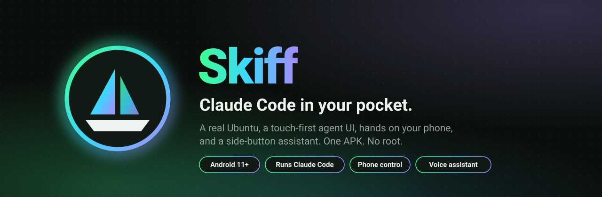
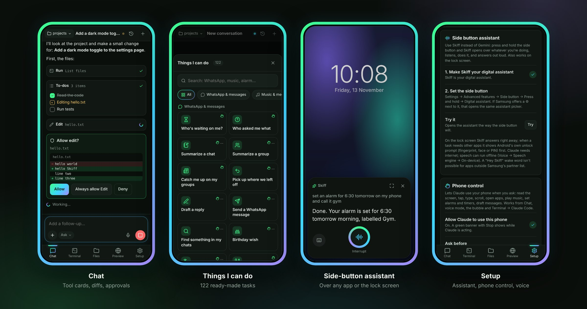
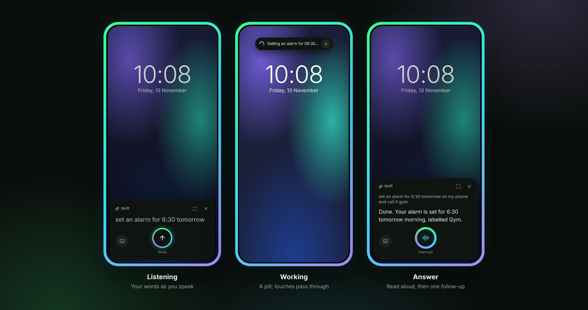
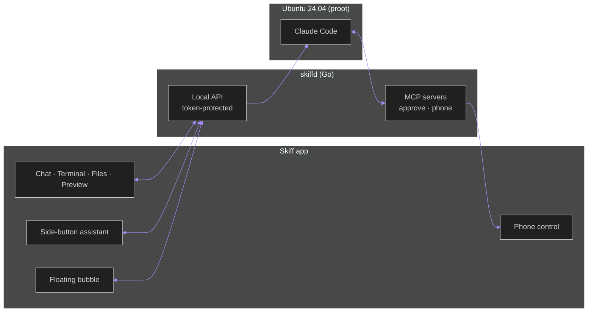

<p align="center">
  
</p>

<p align="center">
  <a href="https://github.com/boparaiamrit/skiff/releases/latest"></a>
  
  
  
</p>

<p align="center">
  <b>Skiff puts a real Ubuntu on your Android phone, installs the official Claude Code inside it,<br>
  and gives it a home made for thumbs.</b><br>
  A chat with tool cards and diffs, terminals, files and a preview pane. Hands that can use your phone.<br>
  A side-button assistant that replaces Gemini. No root, no Termux, no cloud VM. One APK.
</p>

<p align="center">
  
</p>

## Highlights

<table>
<tr>
<td width="50%" valign="top">

**Claude Code, for real**<br>
Ubuntu 24.04 under proot, Claude Code from Anthropic's own installer, your own subscription. Sign in with `/login`; Skiff never sees your credentials.

</td>
<td width="50%" valign="top">

**A chat made for thumbs**<br>
Streaming answers, tool cards, inline diffs, Allow / Deny, questions and plans as cards, modes and models, past conversations across projects.

</td>
</tr>
<tr>
<td valign="top">

**Hands on your phone**<br>
Claude reads the screen, taps, types, scrolls, opens apps, plays music and sets alarms. Risky actions and banking apps ask on screen first, with a Stop banner while it works.

</td>
<td valign="top">

**Side-button assistant**<br>
Hold the side button and talk. A small card listens, works, answers out loud and gets out of the way, over any app or the lock screen.

</td>
</tr>
<tr>
<td valign="top">

**122 things it can do**<br>
Catch up on WhatsApp, "who asked me what", play your liked songs, morning briefing, summarize this page, track orders, review my changes, and more, one tap each.

</td>
<td valign="top">

**Voice that knows when you're done**<br>
Phone speech, on-device or Whisper. Your music pauses while it listens, background noise is filtered out, and every turn ends cleanly.

</td>
</tr>
<tr>
<td valign="top">

**Floating bubble**<br>
A chat head over every app with a gradient ring that turns while Claude works. Questions pop it open; it tucks away while Claude taps.

</td>
<td valign="top">

**Terminal, files, preview, GitHub**<br>
xterm.js with an extra-keys row, a CodeMirror editor, a preview pane for dev servers, and GitHub sign-in, repo picker and clone.

</td>
</tr>
</table>

## The side-button assistant

<p align="center">
  
</p>

One card, one button. Your words appear as you speak; Claude works (shrinking to a pill so your taps reach the app underneath); the answer is read aloud; it listens once more and closes when you are done. Assistant conversations get short, spoken-style answers, and Claude starts warming up while you are still talking. **[How it works →](docs/assistant.md)**

## Get started

1. **Download** the APK from [Releases](https://github.com/boparaiamrit/skiff/releases/latest) and open it on an arm64 phone with Android 11 or newer.
2. **Play Protect.** It may say the app "was built for an older version of Android": choose *Install anyway*. In India and some other countries it blocks apps with an accessibility service outright ("App blocked to protect your device"): Play Store → profile → **Play Protect** → ⚙ → turn off *Scan apps with Play Protect*, install, then turn it back on.
3. **Setup → Install.** Skiff downloads Ubuntu and Claude Code (about 250 MB, 3–10 minutes on Wi-Fi).
4. **Terminal → + → Claude Code**, type `/login` and sign in.
5. **Optional, but the fun part:**
   * **Phone control:** Setup → Phone control → *Turn on* (Accessibility → Skiff phone control).
   * **Side button:** Setup → Side button assistant → *Choose Skiff*, then Settings → Advanced features → Side button → Press and hold → *Digital assistant*.
   * **Bubble:** Setup → Chat bubble.
   * **Background:** allow unrestricted battery so long tasks keep running.

> **Good to know.** *Terminal → Claude Code* is interactive Claude Code and uses your plan's normal limits. *Chat* and the assistant use Claude Code's headless mode (`claude -p`), which since June 15, 2026 draws on your plan's separate monthly Agent SDK credit.

## How it works



* **skiffd** is a static Go binary inside the APK. It serves the UI, terminals, files and the chat bridge on `127.0.0.1`, guarded by a random per-launch token.
* **Chat** drives Claude Code's documented stream-json mode. Permission prompts arrive through a small MCP server and become Allow / Deny cards.
* **Phone tools** are an MCP server Claude Code calls; the app carries them out through an accessibility service and Android intents.

More in **[docs/architecture.md](docs/architecture.md)**, **[docs/phone-control.md](docs/phone-control.md)** and **[docs/assistant.md](docs/assistant.md)**.

## Build from source

```sh
sudo apt install openjdk-17-jdk-headless aapt dalvik-exchange zipalign apksigner
(cd web && npm ci)
./build.sh            # → build/skiff.apk
```

No Gradle, no Android Studio: `build.sh` uses the plain Android tools. Keep the key it creates in `keys/`, because Android only updates an app signed with the same key. Desktop development and the fake Claude Code for testing are in **[docs/building.md](docs/building.md)**.

## Repository

| Path | What's inside |
|---|---|
| [`android/`](android) | The Android app (Java): WebView shell, foreground service, phone control, floating bubble, digital assistant |
| [`server/`](server) | `skiffd` (Go): local API, terminals, chat bridge, MCP servers, setup, Whisper |
| [`web/`](web) | The UI (Preact + htm): the app and the separate, tiny assistant bundle |
| [`test/`](test) | A fake Claude Code for testing the chat and phone pipelines without an account |
| [`docs/`](docs) | Architecture, phone control, assistant, building |

## Roadmap

- [ ] **Cloud reach:** a relay so Claude on claude.ai can use your phone's tools while you're away from it
- [ ] **Browser hands:** Chromium + DevTools as MCP tools; Shizuku as an alternative to accessibility
- [ ] **Git panel:** status, diff, commit and push, and a review screen for a whole turn
- [ ] **Desktop mode:** side-by-side chat and editor for Samsung DeX
- [ ] **Navree agent:** a native agent for workflows beyond Claude Code

See the [changelog](CHANGELOG.md) for what shipped so far.

## Credits and licences

Skiff's own code is dual-licensed **[MIT](LICENSE-MIT) OR [Apache-2.0](LICENSE-APACHE)**.

At setup Skiff downloads `proot` (GPL-2.0) and `libtalloc` (LGPL-3.0) from Termux's package repository and Ubuntu from Canonical; they are not bundled in the APK. The UI bundles [Preact](https://preactjs.com), [htm](https://github.com/developit/htm), [xterm.js](https://xtermjs.org), [CodeMirror](https://codemirror.net), [marked](https://marked.js.org), [DOMPurify](https://github.com/cure53/DOMPurify), [jsdiff](https://github.com/kpdecker/jsdiff) and [Lucide](https://lucide.dev) icons. Whisper speech recognition uses [whisper.cpp](https://github.com/ggml-org/whisper.cpp), built on your phone.

Skiff is an independent project and is not affiliated with or endorsed by Anthropic. Claude and Claude Code are Anthropic's; Claude Code is installed from Anthropic and governed by Anthropic's terms. Security notes are in [SECURITY.md](SECURITY.md).

<p align="center">
  <sub>Built by <a href="https://github.com/boparaiamrit">Amrit Boparai</a> · part of <a href="https://navree.com">Navree</a></sub>
</p>
