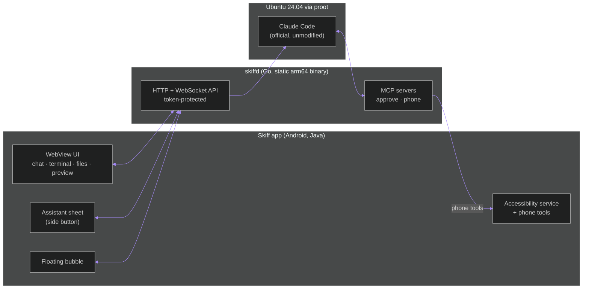

# How Skiff works

Skiff is three small programs that talk over `127.0.0.1`:



## The pieces

| Piece | Where | What it does |
|---|---|---|
| **Android shell** | `android/` | `MainActivity` hosts the UI in a WebView. `SkiffService` is a foreground service that keeps `skiffd` alive, holds an optional wake lock, and runs a tiny token-protected phone server. `SkiffHands` is the accessibility service for phone control. `Bubble` draws the floating chat head; `AssistService`/`AssistSession` make Skiff a digital assistant. |
| **skiffd** | `server/` | A static Go binary shipped as `lib/arm64-v8a/libskiffd.so` and run from the app's native library directory. It serves the UI (embedded with `go:embed`), terminals (PTYs over WebSocket), the chat bridge to Claude Code, files, git and GitHub, Whisper, setup and logs. |
| **UI** | `web/` | Preact + htm, xterm.js, CodeMirror 6, marked + DOMPurify, Lucide icons. esbuild produces two bundles: `app.js` (the full app) and `assist.js` (the side-button assistant, ~150 KB so it opens instantly). |
| **Linux** | downloaded at setup | `proot` and `libtalloc` from Termux's repository (built for Android) and the official Ubuntu 24.04 base image. |

## Startup and security

* The app picks a stable port (default `37321`) and a fresh random token at
  every launch, and starts `skiffd` with them in its environment.
* Every request needs the token: the WebView arrives once with `?t=<token>`,
  `skiffd` turns it into an `HttpOnly`, `SameSite=Strict` cookie and
  redirects to the clean URL. Tools inside Ubuntu use the `X-Skiff-Token`
  header (read from `~/.skiff/session.json`).
* Everything listens on `127.0.0.1` only.
* Skiff never handles Anthropic credentials. You sign in with `/login` in
  Claude Code; the sign-in page opens in your browser.

## Linux without root

* Ubuntu runs under `proot` with a fake root (`-0`) for setup and package
  installs. Claude Code runs as uid 1000 (`-i 1000:1000`) with `HOME=/root`,
  because Claude Code refuses `--dangerously-skip-permissions` as root.
* proot's flags are detected from `--help` (`--kill-on-exit`,
  `--link2symlink`, `--sysvipc`, `-L`, `--kernel-release`).
* Android's CA store is passed to Go (`SSL_CERT_DIR`) and DNS is configured
  explicitly, because a Linux binary on Android sees neither.
* **Why targetSdk 28:** Android blocks apps that target API 29+ from
  executing programs from their own storage. Skiff, like Termux, targets 28
  so proot and Ubuntu's programs can run. That is why Play Protect warns,
  and why Skiff can't be on Google Play in this form.

### Setup steps

1. **runtime**: download `proot` + `libtalloc` `.deb`s, verify SHA-256, unpack.
2. **rootfs**: download and unpack Ubuntu 24.04 (arm64).
3. **configure**: DNS, apt sources (`ports.ubuntu.com`, all components),
   locale, the `skiff` user, shell profile.
4. **packages**: git, curl, ripgrep, Python, `gh`.
5. **claude**: Anthropic's official installer
   (`curl -fsSL https://claude.ai/install.sh | bash`).

Each step leaves a marker, so setup resumes where it stopped.

## Chat: Claude Code's headless mode

The Chat tab drives Claude Code's documented stream-json mode:

```
claude -p --input-format stream-json --output-format stream-json --verbose
  --include-partial-messages --permission-mode <mode>
  --mcp-config ~/.skiff/mcp.json --permission-prompt-tool mcp__skiff__approve
  --allowedTools mcp__phone [--model …] [--resume <session>]
  [--append-system-prompt <short spoken answers>]   # side-button assistant only
```

* **Permission prompts** go through `skiffd mcp-approve`, a tiny MCP server
  that forwards each request to the UI as an Allow / Deny card.
  `AskUserQuestion` and `ExitPlanMode` always ask the user.
* **Mode and model changes, interrupts** use control requests on stdin
  instead of restarting the process.
* **History** comes from Claude Code's own transcripts in
  `~/.claude/projects`, so past sessions resume across app updates.
* **Warm start:** the assistant asks `skiffd` to start Claude Code while you
  are still speaking.

### Usage limits

* **Terminal → Claude Code** is interactive Claude Code and uses your plan's
  normal usage limits.
* **Chat** runs `claude -p`, which since June 15, 2026 draws from your plan's
  separate monthly Agent SDK credit.

## Phone tools

```
Claude Code ─▶ MCP server "phone" (skiffd mcp-phone, inside Ubuntu)
            ─▶ skiffd /api/phone/call
            ─▶ the app's local phone server (token)
            ─▶ SkiffHands (AccessibilityService) and Android intents
```

See [phone-control.md](phone-control.md).

## Voice

Phone speech (Google or Samsung recognizer), the phone's on-device
recognizer, or Whisper (`whisper.cpp` built inside Ubuntu). Text-to-speech
uses Android's TTS. See [assistant.md](assistant.md) for how turns start and
end.
