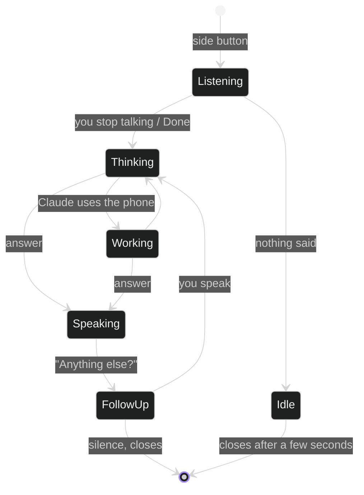

# The side-button assistant

Skiff can replace Gemini on the side button. Press and hold, and a small
voice-first sheet opens over whatever you are doing, or over the lock
screen. It starts listening at once.

## Set it up

1. **Setup → Side button assistant → Choose Skiff**, or Settings → Apps →
   Default apps → Digital assistant app → **Skiff**.
2. Settings → Advanced features → **Side button** → Press and hold →
   **Digital assistant**.
3. **Try** in the same Setup card opens it without the button.

Under the hood Skiff is a `VoiceInteractionService`. Android requires every
assistant to name a speech recognition service; Skiff's forwards to the
phone's own recognizer, so voice typing elsewhere keeps working.

## How a turn goes

* **One card, one button.** Your words appear as you speak; then what it is
  doing ("Searching the web…"); then the answer, read aloud.
* **Your turn always ends.** Phone recognizers differ: some keep listening
  after you stop, some answer "no match" when stopped even though your words
  were on screen. Skiff keeps the last words it heard and ends the turn
  itself about a second after your voice drops back to the room's noise
  (1.8 s without new words at most, 30 s overall). **Done** always sends
  what was heard.
* **Only your voice.** While it listens, Skiff takes Android's audio focus:
  music and videos pause and resume when it closes. The mic level is judged
  against the room's background noise, so noise neither keeps the turn open
  nor makes the ring flicker.
* **No accidental stop.** The big button does nothing while Claude works;
  a separate Stop button does. A tap that lands just as the state changes is
  ignored.
* **Out of the way while it works.** Once Claude starts tapping and typing,
  the card shrinks to a pill at the top ("Opening WhatsApp…", with Stop).
  Everything else lets touches through, and the pill disappears for the
  instant of each tap.
* **Questions and approvals** are one spoken question with big buttons; you
  can also answer out loud ("archive instead", "yes", "no").
* **Short answers.** Assistant conversations get a short system prompt for
  brief, spoken-style replies, and Claude starts warming up while you are
  still talking.
* **Continuity.** Opening it again within 10 minutes continues the same
  conversation; the expand button opens it in the full app.

## Lock screen

The sheet opens over the lock screen and answers right away. When a task
needs other apps, Claude calls `unlock`, which shows Android's own
fingerprint, face or PIN prompt. Skiff never sees your PIN.

## Speech engines

**Setup → Voice → Speech engine**

| Engine | Notes |
|---|---|
| Phone speech | Google's or Samsung's recognizer. Fast, shows words as you speak. |
| On-device | The phone's offline recognizer (Android 12+), where available. |
| Whisper | `whisper.cpp` built inside Ubuntu with the `base` model. Private and offline; uses the phone's noise suppression and echo cancellation. |

Claude itself always needs a connection. A "Hey Skiff" wake word isn't
possible: Samsung's Voice wake-up only lists its partner assistants.
